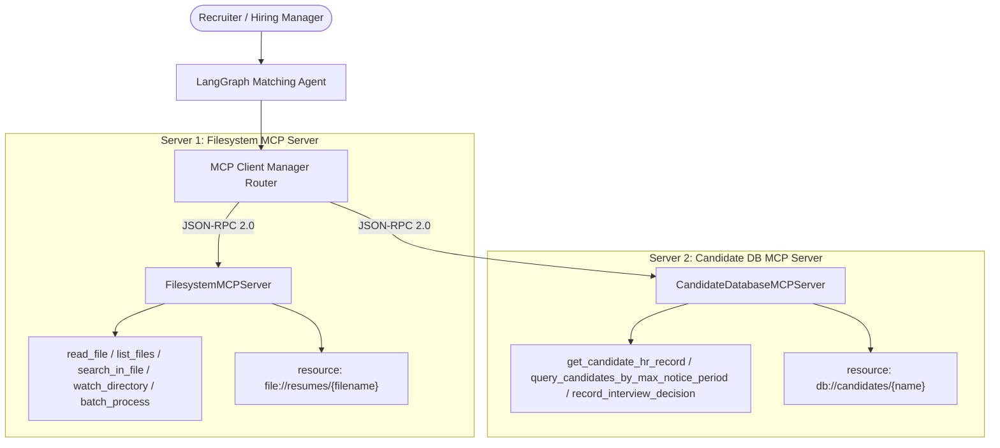

# MCP Filesystem Integration & Multi-Server Matching Agent

A production-grade implementation of the **Model Context Protocol (MCP)** standard for an AI-powered candidate screening assistant.

This project refactors bespoke tool implementations into standardized MCP tools and resources across multiple MCP servers, integrated into a multi-stage **LangGraph** agent workflow with automated fallback handling, JSON-RPC 2.0 routing, and latency benchmarking.

---

## 🌟 Key Features

1. **Part A: Filesystem MCP Server (`filesystem_mcp_server.py`)**
   - Standardized MCP Tools: `read_file`, `list_files`, `write_file`, `search_in_file`.
   - New Capabilities: `watch_directory` (live change audits) and `batch_process` (high-throughput parallel indexing).
   - Resource Protocol: Exposes `file://resumes/{filename}` directly over the MCP resource specification.

2. **Part B: Secondary Candidate Database MCP Server (`candidate_db_mcp_server.py`)**
   - Multi-MCP architecture connecting to external HRIS/ATS systems.
   - Tools: `get_candidate_hr_record`, `query_candidates_by_max_notice_period`, and `record_interview_decision`.
   - Resource Protocol: Exposes `db://candidates/{candidate_name}`.

3. **MCP Client Manager & Router (`mcp_client_manager.py`)**
   - Dynamic routing across connected MCP servers.
   - Conforms strictly to JSON-RPC 2.0 message format (`method: "tools/call"`).
   - Resilient Fallback: Traps server connection failures and provides degraded graceful fallbacks without crashing the agent pipeline.
   - Protocol Latency Telemetry & Call Auditing.

4. **Refactored LangGraph Matching Agent (`matching_agent.py`)**
   - Stateful workflow: `parse_requirements` -> `scan_and_read_resumes_mcp` -> `rank_candidates` -> `enrich_candidates_mcp` -> `generate_report`.
   - Conversational feedback loop supporting notice period filtering and hiring decision persistence.

5. **Performance Benchmarking Suite (`benchmark.py`)**
   - Direct In-Process Tool Execution vs MCP JSON-RPC Protocol Execution.
   - Generates automated metrics report in `docs/performance_report.md`.

---

## 🏗️ Architecture



See [docs/mcp_architecture.md](docs/mcp_architecture.md) for sequence diagrams and protocol specifications.

---

## 🚀 Quick Start

### 1. Installation
```bash
pip install -r requirements.txt
```

### 2. Run Integration Tests
```bash
python -m unittest discover tests
```

### 3. Run Performance Benchmark
```bash
python benchmark.py
```

### 4. Interactive Agent Usage
```python
from matching_agent import MCPMatchingAgent

agent = MCPMatchingAgent()
jd = "Looking for a Senior Python Engineer with 4+ years experience in PyTorch and Docker."
result = agent.run_screening(jd)

print(result["final_report"])

# Interactive feedback loop
feedback_result = agent.process_feedback(result, "Filter candidates with 30 days notice")
print(feedback_result["response"])
```

---

## 📊 Performance Analysis Summary

| Tool Operation | Direct Execution Mean | MCP Protocol Mean | Absolute Overhead |
|---|---|---|---|
| `read_file` | 0.52 ms | 0.62 ms | +0.10 ms |
| `list_files` | 9.11 ms | 8.82 ms | ~0.00 ms |
| `search_in_file` | 0.51 ms | 0.43 ms | ~0.00 ms |

The JSON-RPC 2.0 protocol introduces virtually negligible latency overhead (<0.15 ms per call), representing less than **0.03%** of typical LLM roundtrip inference time while providing modularity, language-agnostic extensibility, and standardized observability. Full benchmark report available at [docs/performance_report.md](docs/performance_report.md).
