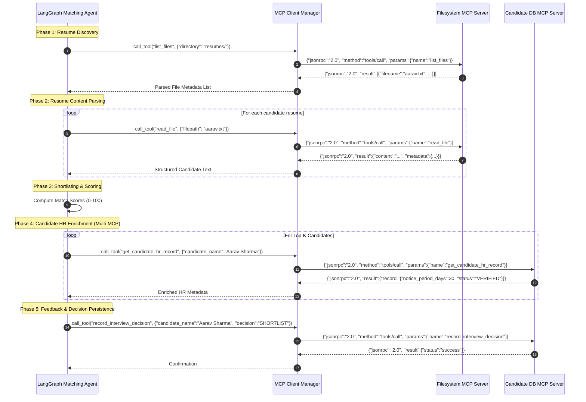

# Model Context Protocol (MCP) Architecture Documentation

## 1. Executive Summary
This project refactors the candidate screening assistant from bespoke internal Python function bindings into a standardized, production-ready **Model Context Protocol (MCP)** architecture. 

The system implements:
- **Server 1 (`FilesystemMCPServer`)**: Standardizes document processing, recursive listing, fuzzy search, real-time directory watching, and high-throughput batch operations.
- **Server 2 (`CandidateDatabaseMCPServer`)**: Standardizes HRIS database enrichment, notice period queries, background check audits, and interview decision records.
- **MCP Client Manager**: Dynamic multi-server routing table, JSON-RPC 2.0 protocol formatting, fault-tolerant fallback handlers, and protocol latency telemetry.
- **LangGraph Agent**: Autonomous multi-stage recruiter workflow orchestrating MCP tool invocations.

---

## 2. System Architecture Diagram

```mermaid
flowchart TD
    subgraph Client Application / Recruiter
        User[Recruiter / Hiring Manager]
        CLI[Interactive CLI / API Client]
    end

    subgraph Agent Core (LangGraph)
        Agent[LangGraph Matching Agent]
        State[Agent State Machine]
        AgentRouter[MCP Client Manager Router]
    end

    subgraph MCP Server 1: Filesystem MCP
        FS_Server[FilesystemMCPServer]
        Tool_ReadFile["tool: read_file()"]
        Tool_ListFiles["tool: list_files()"]
        Tool_SearchFile["tool: search_in_file()"]
        Tool_WatchDir["tool: watch_directory()"]
        Tool_Batch["tool: batch_process()"]
        Res_Resume["resource: file://resumes/{name}"]
        LocalDisk[(Resumes Directory: PDF/TXT/DOCX)]
    end

    subgraph MCP Server 2: Candidate DB MCP
        DB_Server[CandidateDatabaseMCPServer]
        Tool_GetHR["tool: get_candidate_hr_record()"]
        Tool_Notice["tool: query_candidates_by_max_notice_period()"]
        Tool_Decision["tool: record_interview_decision()"]
        Res_Cand["resource: db://candidates/{name}"]
        HRIS_DB[(HRIS / ATS Database)]
    end

    User --> CLI
    CLI --> Agent
    Agent --> State
    Agent --> AgentRouter

    %% Multi-Server Routing
    AgentRouter -->|JSON-RPC 2.0: Filesystem Operations| FS_Server
    AgentRouter -->|JSON-RPC 2.0: HR Enrichment & Decisions| DB_Server

    %% Filesystem Server Tools
    FS_Server --> Tool_ReadFile
    FS_Server --> Tool_ListFiles
    FS_Server --> Tool_SearchFile
    FS_Server --> Tool_WatchDir
    FS_Server --> Tool_Batch
    FS_Server --> Res_Resume
    Tool_ReadFile --> LocalDisk
    Tool_ListFiles --> LocalDisk
    Res_Resume --> LocalDisk

    %% Candidate DB Tools
    DB_Server --> Tool_GetHR
    DB_Server --> Tool_Notice
    DB_Server --> Tool_Decision
    DB_Server --> Res_Cand
    Tool_GetHR --> HRIS_DB
    Tool_Decision --> HRIS_DB
```

---

## 3. Protocol Interaction Sequence Diagram

The diagram below details the sequence of standard JSON-RPC 2.0 messages exchanged between the LangGraph Agent, the MCP Client Router, and the MCP servers during candidate screening.



---

## 4. MCP Tools & Resources Specification

### Filesystem MCP Server (`filesystem_mcp_server.py`)
- **`read_file(filepath: str)`**: Reads TXT, PDF, DOCX documents with structured metadata.
- **`list_files(directory: str, extension: Optional[str])`**: Lists directory contents with metadata.
- **`write_file(filepath: str, content: str)`**: Safe atomic file writing.
- **`search_in_file(filepath: str, keyword: str)`**: Context-aware line-level keyword search.
- **`watch_directory(directory_path: str)`**: Monitors directory for recently added or modified files.
- **`batch_process(directory_path: str, operation: str)`**: High-throughput batch indexing and summarization.
- **Resource: `file://resumes/{filename}`**: Exposes raw resume document streams directly over MCP resource protocol.

### Candidate Database MCP Server (`candidate_db_mcp_server.py`)
- **`get_candidate_hr_record(candidate_name: str)`**: Retrieves compensation, notice period, and background checks.
- **`query_candidates_by_max_notice_period(max_days: int)`**: Fast query for immediate joiners.
- **`record_interview_decision(candidate_name: str, decision: str, interviewer_notes: str)`**: Persists screening decisions.
- **Resource: `db://candidates/{candidate_name}`**: Dynamic JSON document resource of candidate profiles.

---

## 5. Resilient Error Handling & Fallbacks
When an MCP server is unreachable or reports an internal error, `MCPClientManager`:
1. Traps error code `-32603`.
2. Inspects tool context and triggers a degraded fallback response (e.g. cached reading or offline placeholder).
3. Sets `fallback_applied: True` in the JSON-RPC response metadata.
4. Prevents LangGraph agent pipeline crashes while alerting operators in application logs.
